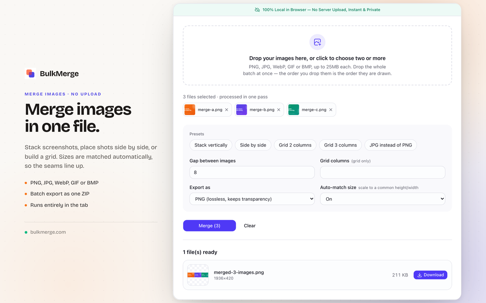
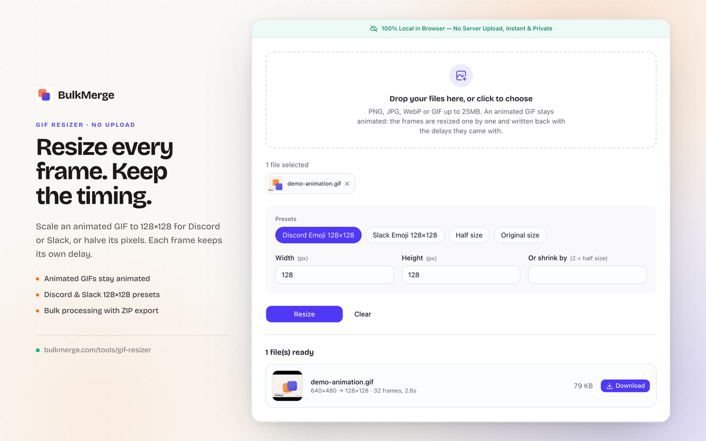
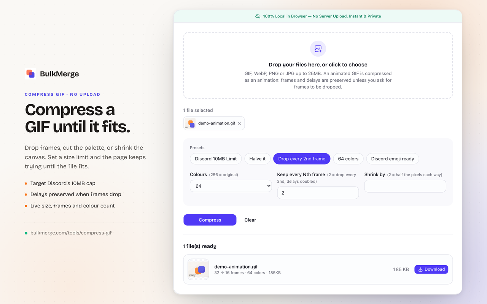

  
  <h1>BulkMerge</h1>
  
<strong>Image and GIF tools that run entirely in your browser.</strong>

  

    <a href="https://bulkmerge.com/">Website</a> ·
    <a href="https://bulkmerge.com/tools/gif-resizer">GIF Resizer</a> ·
    <a href="https://bulkmerge.com/tools/webp-to-gif">WebP to GIF</a> ·
    <a href="https://bulkmerge.com/tools/compress-gif">Compress GIF</a>
  

  

    
    
    
  

BulkMerge is a focused toolkit for the unglamorous image jobs that usually begin with an upload box: stitching two screenshots into one file, resizing an animated GIF for Discord, converting an animated WebP that a chat client refuses, and compressing a GIF until it fits under a 10 MB limit.

Every one of those jobs runs in the browser tab. The file is decoded locally, processed on a canvas, and encoded back to a `Blob`. There is no upload endpoint, no processing queue, no storage bucket, and no cleanup cron. Closing the tab removes the data because it was never sent anywhere.

## Live tools

| Tool | What it does |
| --- | --- |
| [Merge Images Online](https://bulkmerge.com/) | Stack screenshots, place images side by side, or build a grid. Sizes are matched automatically. |
| [GIF Resizer](https://bulkmerge.com/tools/gif-resizer) | Resize every frame to an exact box or a factor. Each frame keeps its original delay. |
| [WebP to GIF Converter](https://bulkmerge.com/tools/webp-to-gif) | Convert animated or still WebP to GIF with frames and timing intact. |
| [Compress GIF](https://bulkmerge.com/tools/compress-gif) | Drop frames, cut the palette, and scale down until the file fits a target size. |

## Features

- **Merge images with automatic size matching** — Stack screenshots vertically, place shots side by side, or build a grid. Each picture is scaled to a common height, width, or cell so the seams line up instead of leaving bands of background. Try [Merge Images Online](https://bulkmerge.com/).
- **Resize animated GIFs frame by frame** — [GIF Resizer](https://bulkmerge.com/tools/gif-resizer) decodes every frame, scales it, and writes the animation back with the delays it came with. One click gives you 128×128 for Discord or Slack.
- **Convert animated WebP to GIF** — [WebP to GIF Converter](https://bulkmerge.com/tools/webp-to-gif) uses the browser's own `ImageDecoder` to split frames and preserve timing. A still WebP becomes a one-frame GIF.
- **Compress GIFs to a target size** — [Compress GIF](https://bulkmerge.com/tools/compress-gif) applies the three levers that actually move bytes: fewer frames, fewer colours, and fewer pixels. Set a limit and the page retries until the file fits.
- **Batch GIF processing with one ZIP** — Process several GIF or WebP files and download the converted results individually or as a single ZIP, written in the tab by a small store-only ZIP writer.
- **Discord and Slack presets** — One click for 128×128 emoji, a 10 MB upload cap, 64 colours, or half-size output.
- **Privacy by construction** — No upload, no account, no file retention. The network panel stays quiet while a file is processed.
- **No network dependency in the processing path** — Once the page is loaded, decoding, scaling, encoding, and ZIP creation are all local function calls.

## Screenshots

### Merge images

### Resize animated GIFs

### Compress GIFs

## Under the hood

BulkMerge is a React 19 application built with TanStack Start and deployed on Cloudflare Workers. The Worker serves the page; it never receives the image.

- **Decode** — `createImageBitmap` handles still images. `gifuct-js` parses GIF blocks, and the app composites each frame's patch rectangle onto a full canvas, honouring the frame's disposal method.
- **Pixels** — Canvas 2D is the baseline. Where the browser exposes `OffscreenCanvas`, the same pipeline uses it to keep the work off the DOM. `imageSmoothingQuality = 'high'` is set for every scale.
- **Encode** — `gifenc` quantizes one shared palette per file and writes LZW-compressed frames. The palette is built from the middle frame with `rgb444` quantization, because per-frame palettes flicker.
- **Compress** — Dropping every Nth frame sums the delays of the frames it replaces, so the clip keeps its running time. Colour reduction and scaling are applied only when a target size demands it.
- **ZIP** — A ~70-line store-only writer builds the archive in memory. GIF, PNG, and WebP are already compressed, so deflating them again would only add CPU.

See [ARCHITECTURE.md](ARCHITECTURE.md) for the longer version, including the cost model and the edge cases that shaped the pipeline.

## Why local-first

Server-side GIF processing is expensive in every dimension that matters to a small tool: a container with ImageMagick or FFmpeg, a queue, temporary storage, egress, cleanup, and a rate limiter to stop someone from turning it into a free transcoding service. A single animated GIF can also exhaust a Worker's CPU or memory budget long before it exhausts a dedicated image service's.

Moving the work to the visitor's machine removes that entire cost centre. The marginal compute cost of a resize is the CPU the visitor already has. The server sends bytes it already had, and no image ever sits in a bucket waiting to be deleted.

The trade-off is real: a browser tab is not a batch render farm. Very large animations are bounded by device memory, and the page says so rather than failing halfway through.

## Limits and browser support

- GIF is limited to 256 colours per file and one-bit transparency. Soft shadows and feathered alpha edges will band; that is the format, not the encoder.
- Re-encoding an already optimised GIF can make it slightly larger. BulkMerge shows the output size before download so you can compare.
- Animated WebP decoding uses `ImageDecoder`, which Chrome, Edge, and Safari support. Firefox does not expose it yet, and the page says so instead of silently returning one frame.
- Everything runs in the tab, so a very large animation is limited by the memory of the device doing the work.
- There is no video editing, no freeform collage, and no server-side API. Those are different products.

## Repository scope

This repository is the public showcase and architecture notes for BulkMerge. The production application source is private. The screenshots and copy are here to document the product and the browser-only approach.

## Links

- Website: <https://bulkmerge.com/>
- [Merge Images Online](https://bulkmerge.com/)
- [GIF Resizer](https://bulkmerge.com/tools/gif-resizer)
- [WebP to GIF Converter](https://bulkmerge.com/tools/webp-to-gif)
- [Compress GIF](https://bulkmerge.com/tools/compress-gif)
